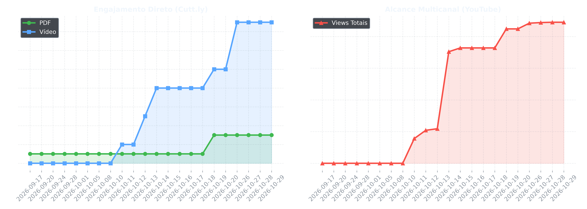

# Green Computing Edu: Sobriedade Digital na Educação
### Artefato Central: Mini-Guia de Eficiência Energética Móvel

[](https://brasil.un.org/pt-br/sdgs/4)
[](https://brasil.un.org/pt-br/sdgs/6)
[](https://brasil.un.org/pt-br/sdgs/7)
[](https://www.gov.br/mec/pt-br/cne/base-nacional-comum-curricular-bncc)
[](LICENSE)
[](https://github.com/naygno/green-computing-edu/actions)

<p align="center">
  <a href="https://github.com/naygno/green-computing-edu/releases/latest">
    
  </a>
</p>

<p align="center">
  
</p>

## 📌 Sobre o Projeto
O **Green Computing Edu** é um projeto multidisciplinar desenvolvido na graduação em Ciência da Computação (UFBRA). A iniciativa capacita educadores e a comunidade escolar na aplicação prática de Lean ICT (TI Enxuta) e Sobriedade Digital, mitigando a pegada ecológica e energética gerada pelo ecossistema de dispositivos móveis.

A ação atua como recurso didático complementar alinhado aos **Temas Contemporâneos Transversais da BNCC** (*Meio Ambiente* e *Ciência e Tecnologia*), fornecendo tutoriais objetivos para estancar o consumo desnecessário de dados e prolongar a vida útil de smartphones.

---

## 📺 Demonstração Prática (IHC)

Para mitigar a fricção cognitiva do material em PDF, os procedimentos de otimização foram mapeados em uma suíte audiovisual vertical (9:16), validando a Interação Humano-Computador (IHC) do projeto em formatos acessíveis e multicanais.

[](https://cutt.ly/mini-guia-edu)

*Os procedimentos demonstram a execução em um Android Virtual Device (Pixel 7), capturado via OBS Studio e editado no Kdenlive.*

---

## 🔬 Fundamentação Epistêmica e Problema de Engenharia

O avanço tecnológico desregulado gerou gargalos críticos abordados por este projeto:

1. **A Crise do Lixo Eletrônico (*E-waste*) e a Lei de Wirth:**
   Segundo o *Global E-waste Monitor 2024* (ONU/ITU), o planeta atingiu a marca de **62 milhões de toneladas de lixo eletrônico por ano**, crescendo 5 vezes mais rápido que a reciclagem formal. O descarte precoce de celulares é acelerado pela incapacidade do hardware legado de processar softwares inchados e sem otimização (*Software Bloat* / Lei de Wirth).
2. **O Consumo Invisível de Rede e a Métrica WUE:**
   Conforme documentado pelo *The Shift Project* (*Lean ICT: Towards Digital Sobriety*, 2019), o consumo elétrico do setor digital cresce cerca de **9% ao ano**. O processamento massivo em nuvem e a transferência ininterrupta de pacotes exigem resfriamento constante em Data Centers, agravando o consumo de água potável medido pelo índice **WUE (*Water Usage Effectiveness*)**, padronizado pelo consórcio *The Green Grid*.
3. **O Custo do Código de Terceiros e o Dreno de Fundo (*Tail Energy*):**
   Pesquisas canônicas de engenharia móvel (Pathak et al., *ACM EuroSys 2012*) comprovam que **até 75% da energia** em aplicações gratuitas é consumida por módulos de telemetria e anúncios de terceiros. Esse tráfego constante mantém os rádios de comunicação (modems 4G/5G) em estados contínuos de alta potência (fenômeno conhecido como *Tail State*), provocando estresse térmico no processador e degradação prematura das baterias de lítio.

---

### 📊 Telemetria de Impacto e Engajamento

O monitoramento do projeto opera sob arquitetura bimodal, diferenciando o tráfego intencional direcionado à comunidade escolar do alcance algorítmico da plataforma de vídeo:

#### 1. Funil de Intenção Direta (Cutt.ly Regular API)
Métricas rastreadas via links encurtados distribuídos nas campanhas ativas de WhatsApp:
* 📄 **Adesão ao Material Escrito (PDF):** <!-- CLICKS_PDF_START -->**3**<!-- CLICKS_PDF_END --> download/confirmação (`cutt.ly/edu-ok`).
* 🎬 **Acessos ao Vídeo Mestre Consolidado (141s):** <!-- CLICKS_VIDEO_START -->**15**<!-- CLICKS_VIDEO_END --> acessos direcionados (`cutt.ly/mini-guia-edu`).
* 🕒 **Última sincronização:** <!-- DATE_START -->(Atualizado em 27/10/2026 às 18:37)<!-- DATE_END -->

#### 2. Alcance e Retenção Audiovisual (YouTube Data API v3 & Studio)
Distribuição multicanal composta por 1 Vídeo Mestre integrador e 4 Microvídeos atômicos (Shorts):

| Identificador | Artefato Audiovisual | Duração | Visualizações | Retenção Média | Função no Funil |
| :---: | :--- | :---: | :---: | :---: | :--- |
| `JK-YXGb64AM` | **Vídeo Mestre: Guia Prático Consolidado** | 2m 21s | <!-- YT_VIEWS_MESTRE_START -->**135**<!-- YT_VIEWS_MESTRE_END --> | 39,67% (0:55) | Demonstração integral (4 passos) |
| `IRFwnNDrrfk` | **Parte 1: Bloqueio de Anúncios e DNS** | 0m 29s | <!-- YT_VIEWS_MV1_START -->**144**<!-- YT_VIEWS_MV1_END --> | 72,16% (0:20) | Entrada de funil / Mitigação Ad Weight |
| `1cBKbu1aVzw` | **Parte 2: Cortando Tráfego de Dados** | 0m 34s | <!-- YT_VIEWS_MV2_START -->**109**<!-- YT_VIEWS_MV2_END --> | 53,16% (0:18) | Restrição de rede em segundo plano |
| `FXA0WiQEX24` | **Parte 3: WhatsApp e Armazenamento** | 0m 49s | <!-- YT_VIEWS_MV3_START -->**37**<!-- YT_VIEWS_MV3_END --> | 72,31% (0:35) | Preservação de memória física |
| `o2LVG3V4gk8` | **Parte 4: Restrição de Bateria** | 0m 33s | <!-- YT_VIEWS_MV4_START -->**19**<!-- YT_VIEWS_MV4_END --> | 28,48% (0:09) | Supressão de Tail Energy |
| **TOTAL** | **Suíte Audiovisual Completa (5 vídeos)** | — | <!-- YT_VIEWS_START -->**444**<!-- YT_VIEWS_END --> | **47,98%** | **Alcance Global do Ecossistema** |

> **Achado de IHC e Retenção no YouTube Studio:** A fragmentação do tutorial em microvídeos (YouTube Shorts) elevou a taxa de retenção média de **39,67%** (Vídeo Mestre de 141s) para picos de **72,16%** (Parte 1) e **72,31%** (Parte 3), comprovando empiricamente que a atomização procedural reduz a sobrecarga cognitiva e maximiza o aprendizado técnico em dispositivos móveis.

> **Nota de Engenharia de Dados (Consistência Eventual):** Pode haver discrepância temporária entre o total exibido nesta tabela e o contador em tempo real na página do YouTube. O pipeline de CI/CD consome a *YouTube Data API v3*, que opera sob arquitetura de Consistência Eventual (*Eventual Consistency*) e cache de borda, atualizando os contadores públicos em lotes com latência de horas em relação ao painel interno (*YouTube Studio*).

---

## 📈 Histórico de Conversão e Impacto

Os dados abaixo são atualizados de forma totalmente automatizada via pipeline de CI/CD (**GitHub Actions + Python + Cutt.ly Regular API + YouTube Data API v3**). A telemetria monitora o alcance do material educativo coletando apenas métricas agregadas de alcance e conversão, sem expor dados pessoais dos usuários.

<p align="center">
  
</p>

---

## 🚀 Artefatos do Projeto

1. **Guia de Sobriedade Digital para Educadores (PDF 9:16):**
   - Distribuído via [GitHub Releases](https://github.com/naygno/green-computing-edu/releases/latest) (versão final sempre em `dist/guia_sobriedade_edu.pdf`).
   - Material diagramado em LaTeX nativo (formato mobile *viewport* 9:16, 16 páginas).
   - Abordagem em 4 eixos práticos: DNS Sinkholing (bloqueio de anúncios na raiz), Economia de Dados Celulares, Supressão de Mídia Automática no WhatsApp e Mitigação de Tail Energy (Modo Avião e Bateria).
2. **Suíte de Microvídeos e Tutorial Consolidado (IHC):**
   - 4 microvídeos atômicos verticais demonstrando cada configuração no Android Virtual Device (AVD).
   - 1 vídeo mestre consolidado (`gc_edu_guia_completo.mp4`) com transições, intertítulos e legendas sincronizadas via Kdenlive.
3. **Pipeline de Telemetria Bimodal Integrada:**
   - Script Python (`scripts/fetch_telemetry.py`) consumindo simultaneamente a **Cutt.ly Regular API** (rastreamento de cliques no PDF e no link direto do vídeo mestre) e a **YouTube Data API v3** (coleta em lote de visualizações dos 5 vídeos), com renderização gráfica em painel bimodal de eixos independentes.
   - Automação periódica via GitHub Actions para atualização de série temporal em CSV e plotagem dinâmica de gráficos comparativos.

---

## 📁 Estrutura de Diretórios

```text
green-computing-edu/
├── .github/
│   └── workflows/
│       └── telemetry.yml          # Automação periódica de dados (CI/CD GitHub Actions)
├── assets/
│   ├── capa_guia_9_16.png         # Imagem vertical para a capa do PDF
│   ├── cerrado_urbano.png         # Banner horizontal de cabeçalho
│   ├── ok_registrado.png          # Endpoint de confirmação do clique
│   ├── qr_cuttly_edu_ok.png       # QR Code apontando para o endpoint do PDF
│   ├── qr_cuttly_video.png        # QR Code apontando para o tutorial em vídeo
│   ├── telemetry_chart.png        # Painel bimodal de gráficos (Cutt.ly vs YouTube)
│   ├── telemetry_history.csv      # Série histórica consolidada da telemetria
│   ├── screenshots/               # 24 capturas de tela numeradas para a cartilha
│   └── videos/                    # Mídia da Sprint 2 (microvídeos, áudios TTS e master)
│       ├── gc_edu_guia_completo.mp4
│       ├── mv1_dns_particular.mp4
│       ├── mv2_economia_dados.mp4
│       ├── mv3_whatsapp_midia.mp4
│       └── mv4_economia_bateria.mp4
├── dist/
│   └── guia_sobriedade_edu.pdf    # Binário compilado final pronto para distribuição
├── scripts/
│   ├── fetch_telemetry.py         # Coleta Cutt.ly + YouTube e plotagem de gráficos
│   ├── format_banner.py           # Aplicação de moldura e cantos arredondados (PIL)
│   ├── record_microvideo.ps1      # Automação de gravação de tela no AVD via ADB
│   └── setup_latex_assets.py      # Download automatizado de QR Codes e placeholders
├── src/
│   └── latex/
│       └── main.tex               # Código-fonte tipográfico do guia (16 páginas)
├── .gitignore
├── LICENSE
└── README.md
```

## 🛠️ Tecnologias e Ferramentas

* **Engenharia de Dados e Automação:** Python 3.11, Pandas, Matplotlib, GitHub Actions, Cutt.ly Regular API, YouTube Data API v3.
* **Emulação e Captura:** Android Studio AVD (Pixel 7 / Android 13/14), OBS Studio (Windows Graphics Capture a 60 fps).
* **Pós-Produção Audiovisual:** Kdenlive (MLT Framework, cortes atômicos, censura pontual, legendas SRT), Edge-TTS (locução neural).
* **Tipografia e Documentação:** LaTeX (`pdflatex`), pacotes `geometry` (9:16), `tcolorbox`, `microtype`, `roboto`.
* **Design Gráfico:** DALL-E 3 (estética 3D Low-Poly do Cerrado urbano), Inkscape, GIMP.
* **Referenciais Normativos:** NBR 14724 / NBR 15287 (ABNT), BNCC / MEC (Temas Contemporâneos Transversais).

---

## 💻 Compilação Local do Documento

Para compilar a cartilha a partir do código-fonte TeX (requer TeX Live ou MiKTeX instalado):

```bash
cd src/latex
pdflatex -interaction=nonstopmode main.tex
```

---

## 📚 Referências

1. Forti, V., Baldé, C.P., Kuehr, R., & Ang, G. (2024). *The Global E-Waste Monitor 2024*. UNITAR/ITU.
2. The Shift Project. (2019). *Lean ICT: Towards Digital Sobriety*.
3. Pathak, A., Hu, Y.C., & Zhang, M. (2012). *Where is the energy spent inside my app? Fine Grained Energy Accounting on Smartphones with Eprof*. ACM EuroSys.
4. The Green Grid. *Water Usage Effectiveness (WUE): A Metric for Data Center Sustainability*.

---

**Autor:** @naygno — *Acadêmico de Ciência da Computação (UFBRA)*
